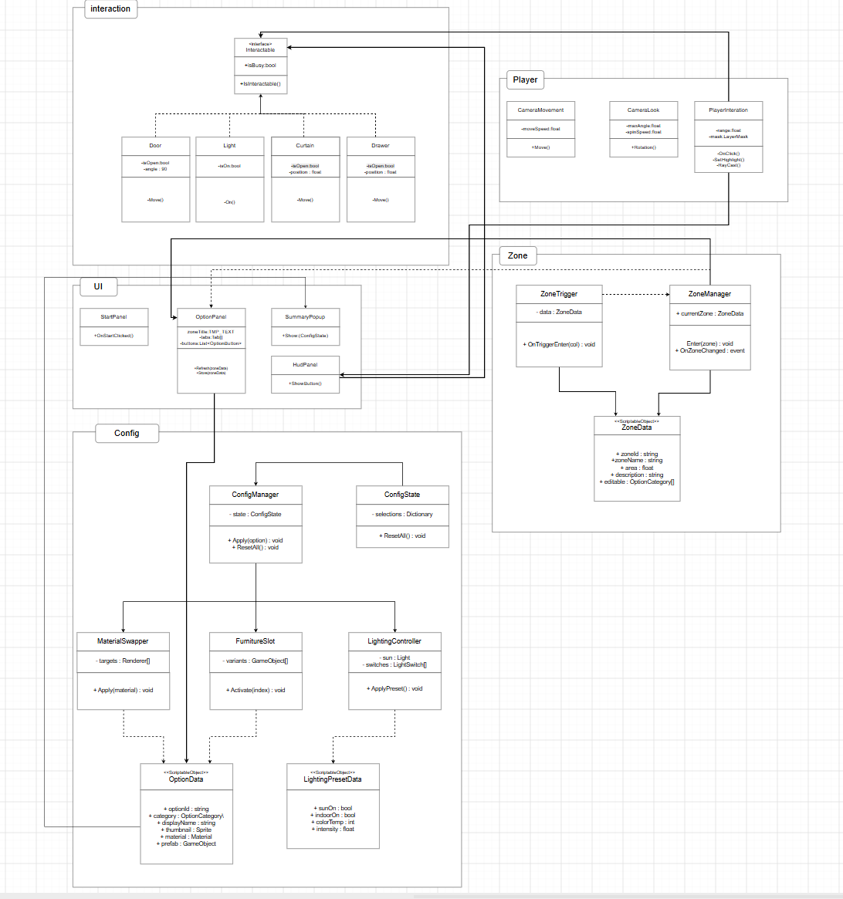

# Model House Configurator — 개발 문서

> 기능 소개와 프로젝트 개요는 [README.md](README.md)를 봐 주세요.
> 이 문서는 **아키텍처 · 코드 구조 · 에디터 도구 · 빌드 방법**을 다룹니다.

Unity 6 / URP 기반의 **1인칭 모델하우스 체험 애플리케이션**입니다.
방문자는 집 안을 직접 걸어 다니며 구역별 정보를 확인하고, 가구와 마감재를 실시간으로 바꿔 본 뒤
마음에 드는 조합을 저장해 비교할 수 있습니다.

| | |
|---|---|
| **엔진** | Unity `6000.6.0f1` (Unity 6) |
| **렌더 파이프라인** | Universal RP `17.6.0` |
| **빌드 타깃** | Windows x64 Standalone (Player) |
| **메인 씬** | `Assets/Scenes/MainSecene.unity` |

---

## 핵심 기능

### 1. 1인칭 탐색
`CharacterController` 기반 FPS 이동. Esc로 커서를 풀어 UI를 조작하고, 빈 화면을 클릭하면 시점 조작으로 돌아옵니다.

### 2. 구역 정보 패널
집을 **8개 구역**으로 나누고, 플레이어가 들어서면 해당 구역의 이름 · 전용면적 · 설명이 자동으로 뜹니다.
구역이 겹치는 경계에서는 가장 나중에 진입한 구역을 보여 주며, 한 프레임 깜빡임이 생기지 않도록 숨김 처리를 `LateUpdate`로 미룹니다.

| 구역 | 전용면적 | 구역 | 전용면적 |
|---|---|---|---|
| 현관 | 8.4 m² | 서재 | 20.7 m² |
| 거실 | 60.4 m² | 욕실 | 5.4 m² |
| 주방 | 20.8 m² | 테라스 | 15.1 m² |
| 방 | 22.4 m² | 휴게실 | 25.0 m² |

### 3. 옵션 변경 (가구 · 마감재)
탭으로 나뉜 설정 패널에서 바닥 / 벽 / 가구 / 조명을 바꿉니다.
가구는 미리 배치해 둔 variant 중 하나만 켜는 방식, 마감재는 지정한 Renderer에 Material을 갈아 끼우는 방식입니다.
가구 교체 버튼의 썸네일은 전용 에디터 도구로 자동 생성합니다.

### 4. 선택 요약 패널
현재 고른 조합이 표 맨 윗줄에 실시간으로 표시되고, **저장**을 누르면 그 아래로 조합이 한 줄씩 쌓입니다 (최대 3개, 초과 시 오래된 것부터 제거).
쌓인 줄을 클릭하면 그 조합 전체가 한 번에 되돌아갑니다. 저장은 세션 메모리에만 남고 파일로는 남기지 않습니다.

### 5. 오브젝트 상호작용
화면 중앙에서 레이를 쏘아 대상을 찾고 `E`로 상호작용합니다. 문 6개, 조명 스위치 4개가 배치되어 있습니다.
가느다란 레이로 못 맞히면 `SphereCast`로 한 번 더 판정해, 전구처럼 작은 물체도 겨냥하기 쉽습니다.

---

## 조작법

| 입력 | 동작 |
|---|---|
| `W` `A` `S` `D` | 이동 |
| `Shift` | 달리기 |
| 마우스 이동 | 시점 회전 |
| `E` | 상호작용 (문 열기/닫기, 조명 켜기/끄기) |
| `Esc` | 커서 해제 (UI 조작 모드) |
| 빈 화면 클릭 | 시점 조작 복귀 |

---

## 아키텍처

### 옵션 시스템 — `OptionGroup` 추상화

이 프로젝트의 중심 설계입니다. **"바꿔 끼울 수 있는 것"을 전부 하나의 타입으로 추상화**해,
요약 패널이 가구인지 마감재인지 알 필요 없이 동일하게 다룹니다.

```
OptionGroup (abstract)          ← 이름표 · 현재 선택 번호 · 기본값 관리
├── FurnitureSlot               variants[] 중 하나만 SetActive
└── MaterialSwapper             targets[] Renderer 에 materials[] 중 하나 적용
```

- 옵션을 바꾸는 모든 경로(버튼 클릭, 프리셋 복원, 초기화)가 `Select(index)` 하나로 수렴합니다.
- `Awake`에서 **씬에 이미 세팅된 상태를 읽어** 시작 번호를 잡습니다. 초기 상태를 코드가 덮어쓰지 않으므로 요약 표가 처음부터 실제 화면과 일치합니다.
- 기존 버튼의 `OnClick` 연결을 깨지 않도록 `Activate(int)` / `Apply(int)` 같은 기존 메서드 이름을 그대로 유지합니다.

`OptionPreset`은 `(OptionGroup, index)` 쌍의 목록으로 한 시점의 조합을 기록하고, `Apply()`로 통째로 복원합니다.

### 상호작용 시스템

```
Interactable (abstract)         ← Prompt 문구 + Interact() 
├── DoorInteractable            경첩 축 기준 회전. 피벗이 경첩이 아니어도 위치+회전 동시 보정
└── LightSwitchInteractable     Light 배열 토글. Baked 라이트면 에디터에서 경고
```

`PlayerInteractor`가 매 프레임 조준 대상을 찾아 `InteractionPrompt`에 안내 문구를 띄웁니다.

### 구역 시스템

`ZoneData`(ScriptableObject)에 이름 · 면적 · 설명을 담고, `ZoneTrigger`(트리거 콜라이더)가 진입/이탈을 `ZoneInfoPanel`에 알립니다.

> 아래는 개발 초기에 그린 클래스 설계도입니다. 구현 과정에서 일부가 바뀌었습니다 —
> `ConfigManager` / `ConfigState` / `OptionData`는 `OptionGroup` + `OptionPreset` + `SummaryPanel` 구조로,
> `ZoneManager`는 `ZoneInfoPanel`로, `LightingController`는 `LightSwitchInteractable`로 통합되었습니다.



---

## 프로젝트 구조

```
Assets/
├── Scripts/                    런타임 스크립트 17개
│   ├── OptionGroup.cs          옵션 추상 베이스
│   ├── FurnitureSlot.cs        가구 교체
│   ├── MaterialSwapper.cs      마감재 교체
│   ├── OptionPreset.cs         조합 기록 / 복원
│   ├── SummaryPanel.cs         요약 표 생성 · 저장 · 되돌리기
│   ├── SummaryRow.cs           요약 표 한 줄
│   ├── ConfigTabController.cs  바닥/벽/가구/조명 탭 전환
│   ├── Interactable.cs         상호작용 추상 베이스
│   ├── DoorInteractable.cs     문
│   ├── LightSwitchInteractable.cs  조명 스위치
│   ├── PlayerInteractor.cs     조준 레이캐스트
│   ├── InteractionPrompt.cs    안내 문구 UI
│   ├── ZoneData.cs             구역 데이터 (ScriptableObject)
│   ├── ZoneTrigger.cs          구역 진입 감지
│   ├── ZoneInfoPanel.cs        구역 정보 표시
│   ├── CameraMovement.cs       1인칭 이동 · 시점
│   └── StartCanvas.cs          시작 화면
├── Editor/                     에디터 전용 도구 4개
├── Scenes/
│   ├── MainSecene.unity        메인 씬 (빌드 대상)
│   └── MainSecene_Furniture.unity
├── Prefabs/                    UI 캔버스 · 방별 가구/마감재 묶음
├── ZoneData/                   구역 ScriptableObject 8개
├── Settings/Build Profiles/    Windows 빌드 프로필
├── ArchVizPRO_Interior_Vol.6_URP/   인테리어 에셋 (유료)
└── Furniture Mega Pack/             가구 에셋 (유료)
```

---

## 에디터 도구

반복 작업을 줄이기 위해 Unity 메뉴에 전용 도구를 만들어 두었습니다.

| 메뉴 | 역할 |
|---|---|
| `Tools > 가구 썸네일 만들기` | `FurnitureSlot`의 variant를 하나씩 렌더링해 투명 배경 PNG로 굽고, 해당 버튼 이미지에 자동 연결 |
| `Tools > 구역 설정 > 선택한 바닥으로 구역 만들기` | 바닥 메시의 바운드를 그대로 써서 구역 트리거 볼륨 생성 |
| `Tools > 구역 설정 > 씬 점검` | 구역 설정 누락 검사 |
| `Tools > 상호작용 설정 > ...` | 선택 오브젝트를 문/조명 스위치로 변환, 콜라이더·실시간 조명 추가, 안내 문구 UI 생성, 설정 점검 |
| `Tools > 요약 패널 레이아웃 적용` | 요약 표를 Vertical Layout Group 구조로 재구성 |

썸네일 베이커는 흰 배경 · 검은 배경으로 두 번 렌더링한 뒤 그 차이로 알파를 역산해, Unity 기본 프리뷰가 버리는 투명도를 정확히 복원합니다.

---

## 시작하기

### 요구 사항
- Unity **6000.6.0f1**
- Git LFS (대용량 에셋 1,700여 개가 LFS로 관리됩니다)

### 클론

```bash
git lfs install
git clone https://github.com/jjh94710/Nugul_Project.git
```

> 유료 에셋(ArchVizPRO Interior Vol.6, Furniture Mega Pack)이 포함되어 Assets 폴더가 약 6.7GB입니다. 클론에 시간이 걸립니다.

### 실행
Unity Hub에서 프로젝트를 열고 `Assets/Scenes/MainSecene.unity`를 재생합니다.

### 빌드
1. `File > Build Profiles`
2. 왼쪽 목록에서 **Windows** 선택 → 활성 프로필이 아니면 **Switch Profile**
3. **Build** 클릭 후 출력 폴더 지정

> 활성 빌드 프로필은 `Library/`에 저장되어 Git으로 공유되지 않습니다. 클론 직후에는 한 번 **Switch Profile**을 눌러야 할 수 있습니다.

---

## 의존 패키지

| 패키지 | 버전 |
|---|---|
| Universal RP | 17.6.0 |
| Cinemachine | 6.6.0 |
| Input System | 1.20.1 |
| AI Navigation | 2.0.14 |
| Timeline | 6.6.0 |
| uGUI | 2.6.0 |
| Visual Scripting | 1.9.12 |

---

## 브랜치

| 브랜치 | 용도 |
|---|---|
| `main` | 배포 기준 |
| `develop` | 통합 개발 |
| `feature-*`, `feat_*` | 기능별 작업 브랜치 |

팀 작업으로 진행되었으며, 기능 단위(요약 패널 · 가구 · 상호작용 · 조명 · 정보 패널)로 브랜치를 나눠 `develop`에 통합했습니다.
